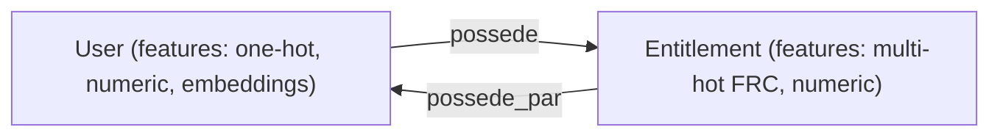
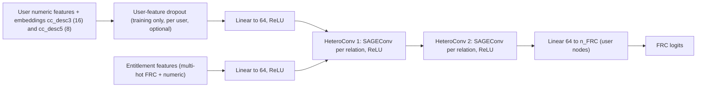

# IAM User FRC Verification with a Graph Neural Network

> **Status:** work in progress · **Last update:** 2026-10-19 · **Stack:** pandas, numpy, scikit-learn, PyTorch, PyTorch Geometric
>
> Items marked `TBD` are figures to fill in from the latest run (see [Descriptive statistics](#3-descriptive-statistics) for the code that produces them).
>
> **What changed since the 2026-10-12 version:** the compliance controls are no longer used as ground truth. They are used after the model, to decide which users are sent for review. The model is trained on the declared FRC only. The convolution is now `SAGEConv` (previously `GATv2Conv`), the violation edge attribute and the residual connections are gone, and accesses carrying a `ViolationStatus` are removed from the graph for all users. The out-of-fold scoring now covers all usable users.

## Table of contents

1. [Context and objective](#1-context-and-objective)
2. [Data description](#2-data-description)
3. [Descriptive statistics](#3-descriptive-statistics)
4. [Graph neural network: objectives](#4-graph-neural-network-objectives)
5. [Graph neural network: architecture](#5-graph-neural-network-architecture)
6. [Training protocol](#6-training-protocol)
7. [Evaluation](#7-evaluation)
8. [Scoring and compliance deliverable](#8-scoring-and-compliance-deliverable)
9. [Explainability](#9-explainability)
10. [Limitations and risks](#10-limitations-and-risks)
11. [Roadmap](#11-roadmap)
12. [Reproducibility and repository layout](#12-reproducibility-and-repository-layout)
13. [Glossary](#13-glossary)

---

## 1. Context and objective

### Context

Within the Identity and Access Management (IAM) perimeter of the bank, each user holds a set of **entitlements** (access rights on applications). Every user carries a declared **FRC (Functional Role Code)** describing their functional role, and every entitlement lists the FRC(s) that are authorised to hold it. By definition, an access is a violation when the user's FRC is not among the FRCs authorised for the entitlement (`userFRC ∉ set(entitlementFRCs)`). Because this rule is deterministic, the real question is not which individual accesses look suspicious, but whether the **user's FRC is correct**: once the FRC is right, the status of every access follows from it.

The compliance team defined four **controls** on the FRCs (listed in [2.5](#25-compliance-controls)). They are plain if/else rules written on the organisation of the user (desk, cost centre). The compliance team did not send us the results: at their request, we automated the four controls and applied them to the user table, which produced the output table `result`. For about 2,000 of the roughly 5,000 users, the controls settle the FRC with certainty: `result` then carries a `decision` different from `unknown` and a `controlledFRC`. Their reach is limited, though. They only cover five of the eight possible FRCs, and for the remaining 3,000 or so users the decision is `unknown`.

An earlier version of this project made a wrong assumption: it applied the controls to the data first and fed the resulting labels to the model, as if the controls were a general ground truth. That is no longer the case. The controls are an independent but partial opinion, valid on a subset of users and a subset of FRCs. They are not used as labels.

### Objective

The model learns, from the declared FRC, what access profile corresponds to each FRC, using the user's attributes and the entitlements they hold (message passing on the user–entitlement graph). Because it is scored out-of-fold, each user receives a probability for their declared FRC from a model that never saw them. When that probability is low, the accesses of the user look like those of other users with a different FRC, so either the declared FRC is wrong or the user holds accesses that belong to another role. The users to send to the compliance team are therefore those with the **highest loss**, restricted to the cases where a review adds information: users for whom the control is `unknown`, or users for whom the control gives an FRC that differs from the one predicted by the model. Where the control already gives an answer that the model corroborates, the control covers the case and no review is requested.

The longer-term ambition is for the model to replace the controls. It would be ideal if it learned them by itself, since the controls should make sense given the data, and it would then give an answer for the 3,000 or so users the controls cannot settle. This is not required for the current deliverable. Since the controls are written on organisational attributes, reproducing them does not prove that the model reads the accesses: the added value of the accesses lies with the users the controls cannot settle.

**Core idea:** the declared FRC is the training target and the **access profile is the evidence**. The controls serve as a second opinion used to prioritise the review.

---

## 2. Data description

### 2.1 Source tables

Received on 2026-09-11 (snapshot dated September 2026), four tables, completed by the output of the controls, which we generated ourselves (see [2.5](#25-compliance-controls)):

| Table | Content |
|---|---|
| `GM_USER_BUNDLES_SEP` | Users, applications, entitlements and bundles |
| `GM_USER_ACCESS_SEP` | One row per user access: `UID`, application, entitlement, user FRC, entitlement FRC, `ViolationStatus`, user type (FO / non-FO) |
| `MyIAMApplicationData20260907` | Application metadata (`AUID`, `ApplicationName`, business line, priority, ...) |
| `Application EntitlementData_20260907` | Entitlement metadata: multi-valued `EntitlementFRCs`, owners, creation and modification dates, official confidentiality and integrity, AppSec profile |
| Controls output (`result`) | Generated by us on 2026-10-15: the four automated controls applied to `df_users_gm`, enriched with `GM Users - DMA FOS.xlsx`. One row per user: `UID`, `decision` (`unknown` or not), `controlledFRC` |

### 2.2 Working dataframes

| Dataframe | Grain | Role |
|---|---|---|
| `df_users_gm` | 1 row per user | User features and declared `User_FRC` |
| `df_users_access` | 1 row per (user, entitlement) | Edges of the graph, with `ViolationStatus` |
| `df_entdata` | 1 row per entitlement held by at least one GM user | Entitlement metadata (dates, FRCs, confidentiality, integrity, AppSec profile) |
| `result` | 1 row per user | Output of the four controls, computed by us (`decision`, `controlledFRC`) |
| `df_apps_merged` | 1 row per application | Application metadata, merged from several per-environment sheets (not yet used in the graph) |

`df_users_gm` and `df_users_access` contain exactly the same set of `UID`. The entitlements of `df_entdata` are a subset of the (much larger) enterprise entitlement catalogue.

### 2.3 Features

**User features**

| Feature | Type | Encoding |
|---|---|---|
| `Region_level_3` | categorical | one-hot |
| `DMA FOS` | categorical | one-hot |
| `user_type` (FO / non-FO) | categorical | one-hot |
| `cc_desc3`, `cc_desc5` (organisational / cost-centre descriptions, hierarchy levels 3 and 5) | categorical, high cardinality | learned embeddings (dim 16 and 8) |
| `nb_droits` (number of retained entitlements, i.e. after the `ViolationStatus` filter) | numeric | standardised |

Missing values are encoded as `MISSING`.

**Entitlement features**

| Feature | Type | Encoding |
|---|---|---|
| `EntitlementFRCs` (comma-separated list of authorised FRCs) | multi-valued categorical | multi-hot |
| `score_priorite`, `alpha_score`, `conf_score`, `int_score` | numeric | standardised (see below) |

**Priority score of an entitlement** (`score_priorite = alpha_score + conf_score + int_score + appsec_score`):

- `alpha` = (modification date − creation date) / (reference date − creation date), clipped to [0, 1]. It measures how much the entitlement has been maintained since its creation.
- `alpha_score` is an integer score from 0 to 10 where **a low `alpha` (entitlement rarely modified) gives a high score**.
- `conf_score` and `int_score` map the official confidentiality and integrity classifications to 1–5, and `appsec_score` maps the AppSec profile (P1 to P4, `TBD` and missing values taking the middle value):

| Level | Low | Moderate | Serious | Undefined / missing | Extreme |
|---|---|---|---|---|---|
| Score | 1 | 2 | 3 | 4 | 5 |

### 2.4 Labels

The training target is the declared `User_FRC`, for every user. It is not overwritten by the output of the controls. Two cases are set aside:

- FRCs with fewer than 5 users are grouped into `AUTRE` (too few examples to learn from);
- users with a missing FRC (`MISSING`) or an `AUTRE` FRC are **always masked**: they are excluded from the loss, the validation set and the test set, but they stay in the graph and keep propagating messages.

### 2.5 Compliance controls

The compliance team defined four controls. We automated them at their request and applied them to `df_users_gm`, enriched with the file `GM Users - DMA FOS.xlsx`, on 2026-10-15. The resulting file is `result`.

| Control | Rule |
|---|---|
| 1 | If `DMA FOS` = Trading, the FRC must be Front Office-Trading or Front Office-Sales Trading (the Excel version applies it to users whose status is Ok) |
| 2 | If `DMA FOS` = Sales, the FRC must be Front Office-Sales |
| 3 | If the user (headcount) belongs to eCommerce Client Solutions (`cc_desc3`), the FRC must be Front Office-COO Transversal Electronic Client Solutions |
| 4 | If the user belongs to one of the following cost centres, the FRC must be Front Office-Others: Business Development, Client Development, COO Office (excluding eCommerce Client Solutions), Management, Markets 360, PRM Team, Quant Research (e-FIC and Lab), Quantitative Research, Strategic Oversight Office, Support function/Assistants |

These four rules cover five FRCs, which is why the controls only reach five of the eight FRCs. Used in this project, a rule that applies to a user gives the FRC they must hold, and when no rule applies, `decision` is `unknown`.

All four rules are written on `DMA FOS` and on cost-centre descriptions, which are also inputs of the model (one-hot for `DMA FOS`, embeddings for `cc_desc3` and `cc_desc5`). The controls are therefore a function of the model's features, a point that matters for interpreting the agreement between the model and the controls ([7.4](#74-agreement-with-the-controls-and-stability)).

The controls are not part of the training signal. They are kept in an aligned structure (`controlled_aligned`, `is_controlled`) and used for two purposes: choosing which users enter the compliance deliverable ([section 8](#8-scoring-and-compliance-deliverable)) and, as planned, measuring whether the model retrieves the controls by itself ([section 7.4](#74-agreement-with-the-controls-and-stability)).

### 2.6 `ViolationStatus`

The `ViolationStatus` field is entered manually and covers only a limited share of accesses. Since an access is a violation exactly when the user's FRC is not authorised by the entitlement, this flag is a consequence of the FRC and no longer an independent label. It is not used as an edge attribute. Accesses with a non-null `ViolationStatus` are **removed from the graph for all users**, so every user is treated in the same way. Users whose accesses are all flagged disappear from the graph and are not scored.

---

## 3. Descriptive statistics

> Fill the tables below with the output of the snippet at the end of this section.

### 3.1 Graph size

| Quantity | Value |
|---|---|
| Users | TBD |
| Entitlements | TBD |
| Access edges (user → entitlement) | TBD |
| Graph density | TBD |
| Accesses removed (non-null `ViolationStatus`) | TBD % |
| Users with at least one removed access | TBD % |
| Users lost because all their accesses were removed | TBD |

### 3.2 Labels

| Quantity | Value |
|---|---|
| FRC classes used for training (excluding `AUTRE` and `MISSING`) | TBD |
| Users with a usable FRC | TBD |
| Users masked (`MISSING` / `AUTRE`) | TBD |
| Smallest / largest class | TBD / TBD |

Add: bar chart of the FRC class distribution (long tail expected).

### 3.3 Compliance controls

| Quantity | Value |
|---|---|
| Users decided by the control (`decision` ≠ `unknown`) | TBD (about 2,000 expected) |
| Users undecided (`decision` = `unknown`) | TBD (about 3,000 expected) |
| Controlled users whose `controlledFRC` equals the declared FRC | TBD % |
| FRCs covered by the controls | 5 of 8 |

The agreement between the control and the declared FRC is the first indication of how reliable the declared FRC is on the controlled subset.

### 3.4 Users and entitlements

| Quantity | Mean | Median | P90 | P99 | Max |
|---|---|---|---|---|---|
| Entitlements per user (`nb_droits`) | TBD | TBD | TBD | TBD | TBD |
| Authorised FRCs per entitlement | TBD | TBD | TBD | TBD | TBD |

Add: distribution of user types (FO / non-FO), confidentiality and integrity levels, and the `alpha` distribution.

### 3.5 Snippet

```python
# Run the first two lines BEFORE the ViolationStatus filter (section 4 of the notebook)
share_removed = df_users_access["ViolationStatus"].notna().mean()
users_with_removed = df_users_access.loc[df_users_access["ViolationStatus"].notna(), "UID"].nunique() / df_users_access["UID"].nunique()

# Graph size and labels
stats = {
    "users": n_users,
    "entitlements": n_ent,
    "access edges": edge_index_user_ent.shape[1],
    "density": edge_index_user_ent.shape[1] / (n_users * n_ent),
    "FRC classes (trainable)": len(frc_labels_final),
    "users with usable FRC": len(idx_known),
    "users masked (MISSING / AUTRE)": n_users - len(idx_known),
    "users decided by the control": int(is_controlled.sum()),
    "users undecided": int((~is_controlled).sum()),
}
print(pd.Series(stats))

# Controls versus declared FRC
declared = pd.Series(frc, index=X.index)
print(result["decision"].value_counts())
print("control = declared FRC:", (controlled_aligned[is_controlled] == declared[is_controlled]).mean())

# FRC distribution
print(pd.Series(frc_regroupe).value_counts())

# Distributions
q = [0.5, 0.9, 0.99]
print(users_features["nb_droits"].describe(percentiles=q))
print(ent_multi_hot.sum(axis=1).describe(percentiles=q))
print(users_features["user_type"].value_counts(normalize=True))
print(ent_features["Official Confidentiality"].value_counts(normalize=True))
print(ent_features["Official Integrity"].value_counts(normalize=True))
```

---

## 4. Graph neural network: objectives

The GNN is used as a **semi-supervised node classifier on users**. It predicts the FRC of each user from two sources of information: their own attributes, and the entitlements they hold and, through those entitlements, the other users who hold the same ones. A graph is a natural fit because a user's role is revealed by what they have access to and by who else has the same accesses. Message passing captures this directly, whereas a flat model on a user × entitlement matrix only captures it indirectly.

The convolution is `SAGEConv`. For each node, it combines a transformation of the node's own representation with the mean of its neighbours' representations. It has fewer moving parts than an attention mechanism, which suits the current setting where the graph has no edge attributes, and its own-representation term lets a user keep their identity next to what their entitlements say about them.

The output is used in two ways. In training, the model learns which accesses are typical of each FRC. At scoring time, a confident disagreement between the predicted FRC and the declared FRC, obtained **out-of-fold**, means that the user's accesses look like those of another role. This is the signal that, combined with the status of the compliance control, determines the users sent for review (see [section 8](#8-scoring-and-compliance-deliverable)). If the model turns out to reproduce the controls, the same output could later give an answer for the users the controls cannot settle.

**Main risk: learning the FRC from the organisation instead of the accesses.** Cost centre, region and team may almost determine the FRC. The compliance controls themselves are written on `DMA FOS` and cost-centre descriptions, which shows how directly these attributes can fix the FRC for part of the users. A model that can read them can reproduce the declared FRC without looking at the accesses, and a user whose accesses do not fit their FRC would then still be "predicted" as their declared FRC, which hides the case. Two ways to counter this are compared:

- **remove** the user features (`accessOnly`): any mismatch comes from the accesses, but the task is harder;
- **keep** them but train the model to cope without them (**user-feature dropout**, see [5.3](#53-user-feature-dropout)): the model can use the organisation when it helps, but is forced to learn what the accesses say.

Questions the experiments answer:

1. How much of the FRC is explained by access patterns alone? (`accessOnly` variant)
2. Does user-feature dropout make the model rely more on the accesses, without losing too much on the FRC task? (`userDrop` variant, compared with `accessOnly`)
3. How well does the model retrieve the controlled FRC on the users decided by the control? (see [section 7.4](#74-agreement-with-the-controls-and-stability))
4. What does the GNN bring compared with simple baselines? (see [section 7.5](#75-baselines))

---

## 5. Graph neural network: architecture

### 5.1 Graph schema



The graph is heterogeneous (`HeteroData`) with two node types, `user` and `entitlement`. Edges are **bidirectional**, which is required for message passing in both directions, and they carry no attribute: the violation flag has been dropped, since it is a function of the very label being predicted. Application and bundle nodes are not part of the current graph. They are considered for a later iteration (see [Roadmap](#11-roadmap)).

### 5.2 Model



| Component | Detail |
|---|---|
| Categorical user inputs | `cc_desc3` and `cc_desc5` through `nn.Embedding` (dimensions 16 and 8), concatenated with the numeric tensor |
| User-feature dropout | Optional, training only (see [5.3](#53-user-feature-dropout)) |
| Input projections | `Linear(in_dim, hidden)` + ReLU, separately for users and entitlements (hidden size 64 or 128, see the grid in [section 6](#6-training-protocol)) |
| Message passing | 2 × `HeteroConv` with one `SAGEConv` per relation (mean aggregation of neighbours plus a linear term on the node's own representation), sum aggregation across relations |
| Non-linearity | ReLU after each convolution |
| Classifier | `Linear(hidden, n_FRC)` applied to user embeddings |
| Outputs | FRC logits and user embeddings (usable for clustering or visualisation) |
| Mode | Full-batch, transductive (the whole graph is visible during training, only the labels of the training users are used) |

The residual connections used with `GATv2Conv` are not needed here: `SAGEConv` already carries a term on the node's own representation, so the state of a node is not replaced by the aggregate of its neighbours.

### 5.3 User-feature dropout

**Mechanism.** At each training epoch, every user independently loses **all** of their features (one-hot, numeric and both embeddings) with probability `p`. For these users the input of the projection is a zero vector, so they all start from the same bias-only vector and are only distinguishable through their accesses. The mask is redrawn at every epoch. With a high `p`, such as the value 0.8 used in earlier experiments, most users have no features in a given epoch, so training is close to the `accessOnly` setting, and the features are only used for the remaining share.

- **Training only.** At evaluation and inference, no user is dropped.
- **No rescaling:** the whole feature vector is dropped, not individual coordinates.
- **Dropped users stay in the loss and in the graph.** They still have their label and still receive messages. The only way to reduce the loss on them is to read their accesses, which is the point.
- **Why per user and not per epoch.** Dropping a random share of users in every epoch exposes the model to both situations (with and without features) within each epoch and in the same graph. The alternative, dropping the features of all users in a fraction of the epochs, was considered and not retained.
- **Same setting everywhere:** grid, final model and every fold of the out-of-fold scoring must use the same `p`.
- **Current status:** the dropout is implemented (`p_user_drop`), but the current grid runs with `p = 0`. The rate has not been tuned.

**Difference with `accessOnly`.** `accessOnly` never gives the user features to the model. Dropout lets the model use them when they are available, but trains it to cope without them. It has **no effect on `accessOnly`**, since there are no user features to drop.

### 5.4 Variants compared

| Variant | User features | User-feature dropout |
|---|---|---|
| `BASE` | yes | no |
| `accessOnly` | no | not applicable |
| `userDrop` | yes | `p` per user at each epoch |

The entitlement FRC features (`EntitlementFRCs`) are kept in all variants. The variants that carried the violation attribute on the edges (`violEdges` and its combinations) were removed with that attribute.

---

## 6. Training protocol

| Item | Choice |
|---|---|
| Loss | Cross-entropy with class weights `w_c = N_train / (K · n_c)` computed on the training set |
| Optimiser | Adam, weight decay 5e-4 |
| Grid | Hidden size {64, 128} × learning rate {0.001, 0.005}, best configuration kept |
| Epochs | Up to 300, early stopping with patience 20 on validation macro-F1 |
| User-feature dropout | `p_user_drop`, `userDrop` variant only (0 in the current grid) |
| Seed | Fixed (`torch.manual_seed`, seed 0) |
| Masking | `MISSING` and `AUTRE` users excluded from loss, validation and test |

Early stopping uses the validation macro-F1 computed in evaluation mode, i.e. **with all user features active**. This matches the way the out-of-fold scores are currently produced. If the team decides to score from the accesses alone (features zeroed), the validation score must switch to the same regime (see [7.3](#73-reliance-on-user-features)).

**Splits** (stratified by FRC, on users with a usable FRC): 20 % of the users form a test set that is never used for selection, and the rest is split 75 / 25 into train and validation, i.e. 60 % / 20 % / 20 % of usable users.

**Out-of-fold scoring:** 5-fold stratified cross-validation over **all usable users**, so that every user, including the users of the test split, receives a prediction from a model that did not train on them. This is needed because the compliance list ranks every usable user. Each fold model is trained for `max(best_epoch, 50)` epochs with the configuration of the selected variant (including its dropout setting). The test split is still evaluated separately with the final model and stays the clean reference figure. See [section 8](#8-scoring-and-compliance-deliverable).

Each run writes its console output to `runs/run_<timestamp>.txt`.

---

## 7. Evaluation

The model is not meant to predict the FRC as accurately as possible. Its job is to learn what a typical set of accesses looks like for each FRC, so that the users who deviate from it stand out. A high FRC score therefore only shows that the model has learned the typical patterns. It does not show that the model finds the right users. A score that is too high can even be a warning sign: the model may have memorised the training users, or it may be reading the FRC from the organisation (cost centre, team) instead of from the accesses, which would hide exactly the cases we are looking for.

For this reason the evaluation answers four questions in sequence, from the most basic to the most important one.

| Step | Question | How it is answered | Section |
|---|---|---|---|
| 1 | Has the model learned the FRC task? | Macro-F1, balanced accuracy, accuracy and per-class report on held-out users | [7.1](#71-sanity-check-on-the-frc-task) |
| 2 | Which design choices make a difference? | Comparison of `BASE`, `accessOnly` and `userDrop` | [7.2](#72-ablation-grid) |
| 3 | Does the model look at the accesses or at the organisation? | Same model run with user features active, then zeroed | [7.3](#73-reliance-on-user-features) |
| 4 | Does it agree with the controls where they decide, and is its ranking stable and confirmed by compliance? | Agreement with `controlledFRC`, stability across seeds, compliance review | [7.4](#74-agreement-with-the-controls-and-stability) |

Steps 1 and 2 are a standard model assessment. Steps 3 and 4 are specific to this project, and they are the ones that decide which model is kept.

### 7.1 Sanity check on the FRC task

The first check is that the model has learned something: given the accesses of a user (and, depending on the variant, their attributes), can it recover the declared FRC? We report the **macro-F1**, which gives every FRC the same weight. The classes are strongly imbalanced, and plain accuracy is dominated by the largest ones, so a model that always predicts the most populated class can look good on accuracy alone. Macro-F1 is also the criterion used for early stopping and for choosing the configuration. Balanced accuracy and accuracy are reported alongside it, together with a per-class report and a confusion matrix that show which FRCs get mixed up.

| Metric | Computed on | Purpose |
|---|---|---|
| Macro-F1 | Validation users | Early stopping and comparison of variants |
| Macro-F1, balanced accuracy, accuracy, per-class report, confusion matrix | Test users, never used for selection | Clean performance figure for the selected model |
| Macro-F1, balanced accuracy, accuracy and per-class precision / recall (per fold) | Out-of-fold group (all usable users) | Check of the scores that feed the compliance list |

We expect a good score but not a perfect one. Users whose accesses do not fit their declared FRC are precisely the ones the model should "miss", so a score close to 100 % would be suspicious rather than reassuring.

### 7.2 Ablation grid

To understand which design choices matter, the three variants of [5.4](#54-variants-compared) are trained with everything else identical: hidden size and learning rate chosen in the grid, ideally averaged over several seeds so that small differences can be told from noise. The current grid only runs `BASE`, the two other variants are to be run.

| Variant | User features | Val. macro-F1 | Test macro-F1 | Test balanced acc. | Best epoch |
|---|---|---|---|---|---|
| `BASE` | yes | TBD | TBD | TBD | TBD |
| `accessOnly` | no | TBD | TBD | TBD | TBD |
| `userDrop` | yes (dropped) | TBD | TBD | TBD | TBD |

The comparisons that matter, and how to read them:

| Comparison | What it tells us |
|---|---|
| `accessOnly` vs `BASE` | If they are close, the user attributes add little and the accesses carry the signal. If `accessOnly` is far below, the model leans on organisational attributes, which is the shortcut we want to avoid. |
| `userDrop` vs `BASE` | With the features active, `userDrop` is expected to be similar or slightly lower. A lower value is not a failure, since the model can no longer rely on the features alone. |
| `userDrop` vs `accessOnly` | If `userDrop` is clearly better, keeping the features while forcing the model to read the accesses pays off. If they are equal, the features add nothing and `accessOnly` is the simpler choice. |

Differences smaller than the seed-to-seed standard deviation should not be interpreted. Because macro-F1 on the FRC task is only a sanity check, none of this table decides on its own which variant is kept: that is the role of steps 3 and 4.

### 7.3 Reliance on user features

This step addresses the main risk of the project directly. Each trained model that has user features is run twice on the same test users: once normally, and once with **all user features set to zero**, through the `user_feat_mask` argument of the forward pass. If the predictions barely change, the model is reading the accesses. If they collapse, it was reading the organisation.

| Model | Test macro-F1, features active | Test macro-F1, features zeroed | Prediction agreement |
|---|---|---|---|
| `BASE` | TBD | TBD | TBD |
| `userDrop` | TBD | TBD | TBD |
| `accessOnly` (reference) | TBD | not applicable | not applicable |

```python
zero_mask = torch.zeros(n_users, 1)

def reliance(model, x_ent, mask=test_mask):
    model.eval()
    with torch.no_grad():
        lg_a, _ = model(x_user_num, x_user_emb, edge_index_dict_base, x_ent)
        lg_z, _ = model(x_user_num, x_user_emb, edge_index_dict_base, x_ent,
                        user_feat_mask=zero_mask)
    yt = y[mask].numpy()
    pa, pz = lg_a[mask].argmax(1).numpy(), lg_z[mask].argmax(1).numpy()
    f1 = lambda p: f1_score(yt, p, average="macro", zero_division=0)
    return f1(pa), f1(pz), (pa == pz).mean()
variantes = {
    "BASE":       dict(access_only=False, p_user_drop=0),
    "userDrop":   dict(access_only=False, p_user_drop=0.8),
    "accessOnly": dict(access_only=True,  p_user_drop=0),
}
rows = []
for nom, kw in variantes.items():
    m_v, _, _ = entrainer(hidden_dim=HD, lr=LR, n_epochs=300, dims_emb=dims_embedding, seed=0, **kw)
    f1_a, f1_z, accord = reliance(m_v, x_ent_full)
    ao_v = kw["access_only"]
    rows.append(dict(model=nom, f1_features_actives=f1_a,
                     f1_features_a_zero=None if ao_v else f1_z,
                     accord_predictions=None if ao_v else accord))
display(pd.DataFrame(rows).round(4))
```

The results reveal a strong dependence on user features for both models.

For `BASE`, test macro-F1 falls from 0.8388 to 0.1155 when all user features are zeroed. For `userDrop`, it falls from 0.8225 to 0.1733. In both cases, the resulting scores are substantially lower than the 0.7102 test macro-F1 obtained by `accessOnly`, which is trained without user features from the beginning.

The prediction agreement is also low: only 39.87 % for `BASE` and 38.09 % for `userDrop`. This means that zeroing the user features changes the predicted FRC for most test users. The model's predictions are therefore strongly influenced by organisational attributes, rather than being determined primarily by the access graph.

**What this means for `userDrop`.** Although dropout does not eliminate the model's reliance on user features, `userDrop` remains a promising candidate. It achieves the best test macro-F1 (0.84) and balanced accuracy (0.92) in the ablation grid. Its score with features zeroed (0.1733) is also higher than that of `BASE` (0.1155), suggesting some improvement in its ability to cope without those features. However, this improvement remains limited, and the zeroed-feature score is still far below the `accessOnly` reference (0.7102).

Consequently, `userDrop` will still be considered for the next stage of the project. Rather than discarding it because of its reliance on user features, the next experiments will investigate whether tuning the dropout rate can preserve its strong classification performance while encouraging the model to learn more from access patterns. Its usefulness will ultimately be judged by its ability to identify users with potentially incorrect FRCs, not by macro-F1 alone.

**A limit of the check.** With per-user dropout, the model is trained on graphs where a share of the users has no features, never on a graph where every user has none. Zeroing all users at inference is therefore a slightly new situation for the model, so this check is an indicator rather than the exact performance of an `accessOnly` model.

**Which regime is validated and scored.** A dropout model can be used in two ways: scoring the users with their features active, as the pipeline does today, or scoring them from their accesses alone, with the features zeroed. The validation score used for early stopping must follow the same regime as the scoring. Otherwise the model is selected for a situation in which it will not be used. Today both use the features-active regime. If the team decides to rely on the accesses alone for the compliance list, the validation, the early stopping and the out-of-fold scoring all have to switch together to the zeroed regime.

### 7.4 Agreement with the controls and stability

Steps 1 to 3 say whether the model is sound. They do not say whether it finds the right users. Two independent pieces of evidence are available: the compliance controls, and the review done by the compliance team.

**Agreement with the controls (planned).** On the users decided by the control, the controlled FRC is an independent point of comparison. The planned check compares the FRC predicted out-of-fold with `controlledFRC` on these users, and reports the metrics separately for the controlled and the undecided users. A high agreement would be encouraging for the longer-term goal of replacing the controls, since it would mean that the model recovers by itself what the if/else rules encode. It is not required for the current deliverable. A low agreement on a subset of FRCs would be informative too, since it either points at limits of the model or at controls that do not match the declared FRCs. Because the controls cover only five of the eight FRCs, this agreement can only be measured on those.

**Stability.** The top 100 users should largely overlap between seeds and folds, otherwise the ranking is not reliable enough to hand to compliance.

**Human review.** Compliance returns the confirmed FRC of the users of the list, the top 20 and 20 random users. Comparing how often the declared FRC and the model's FRC are confirmed in each sample shows whether the top of the ranking is really worse than an ordinary user. The first review is reported in [Section 8](#results-of-the-first-compliance-review).

### 7.5 Baselines

To know what the GNN actually brings, it is compared with three simple models:

| Baseline | Idea |
|---|---|
| Entitlement vote | Predict the FRC authorised by the largest number of the user's entitlements, i.e. the candidate FRC with the fewest violating accesses |
| Logistic regression | Sparse user × entitlement matrix + user features |
| Attribute-only model | Organisational attributes without any access information |

The attribute-only model is also a diagnostic for the shortcut described in [section 4](#4-graph-neural-network-objectives): if it is almost as good as the full model, the organisation alone explains most of the FRC.

### 7.6 Limits of the evaluation

The target is the declared FRC, which is itself noisy. A misclassified user is therefore not simply a model error: it can be a user whose declared FRC does not match their accesses, which is the very case the deliverable looks for. This is why the FRC score is read as an indicator of how well the model captures typical access patterns, and not as a goal: a model that fits the training users too closely would hide the cases we want to find.

The hyper-parameters were selected on the validation users, who are also part of the out-of-fold group. The out-of-fold metrics are therefore slightly optimistic, and the test split remains the reference for a clean performance figure.

---

## 8. Scoring and compliance deliverable

For every usable user (all users with a declared FRC other than `MISSING` and `AUTRE`), the out-of-fold probabilities give:

| Column | Meaning |
|---|---|
| `frc_declare` | Declared FRC (training target) |
| `frc_predit` | FRC predicted by the model |
| `proba_declare` | Out-of-fold probability of the declared FRC (low = the accesses do not fit the declared role) |
| `loss` | Cross-entropy of the declared FRC, `-log(proba_declare)` |
| `mal_predit` | True when the predicted FRC differs from the declared one |
| `decision` | Decision of the compliance control for this user (`unknown` when undecided or absent from `result`) |

**Interpretation:** a mismatch does not prove that the declared FRC is wrong. It means that the user's access profile resembles that of another FRC, which can come from an incorrect FRC or from accesses that do not belong to the declared role. Out-of-fold scoring matters here: a model scoring a user it was trained on could memorise their atypical accesses and still predict the declared FRC, which would hide the case.

**Deliverable for the compliance team (manual re-verification)** has two parts:

1. the **top 20 users by decreasing loss**, restricted to users for whom the control is `unknown`, or for whom the control is decided but its FRC differs from the FRC predicted by the model;
2. **20 users drawn at random from all usable users** (outside the top 20, with no restriction on the control), as a reference sample.

The restriction on the top 20 directs the review to where it brings information, namely where the controls give no answer or disagree with the model. The random sample is deliberately unrestricted so that it can serve as a baseline for the whole population, and the `decision` column makes it possible to tell the two groups apart in the analysis. The file is produced in a full version, with all the columns above, and in a simple version (`user_id`, `frc_declare`, `frc_predit`).

**Manual verification procedure** (to be automated): for each flagged user, go through their entitlements and check whether the FRC predicted by the GNN is the majority FRC among the holders of that entitlement.

**With a dropout model**, a second score can be computed with all user features zeroed at inference (access-driven regime, see [7.3](#73-reliance-on-user-features)): `p_acces_declare`. Users whose declared FRC is likely with the features but unlikely from the accesses alone (large gap between the two scores) are those for whom the organisation explains the FRC but the accesses do not.

Users with `MISSING` or `AUTRE` FRC have no label and are not in the out-of-fold group. They can be scored with the average of the fold models, which have not been trained on them.

### Results of the first compliance review

The first list (the top 20 users by decreasing loss, and 20 users drawn at random) was sent to the compliance team on TBD for manual re-verification, and their answer came back on TBD. This first list was drawn before the restriction based on the controls was introduced: the top 20 was taken over all scored users. For each user, compliance was given the FRC predicted by the model (TBD: and the declared FRC) and returned the **confirmed FRC**, i.e. the FRC the user actually holds. The model that produced the list is TBD (variant, dropout setting, scoring regime). The reviewers were TBD (told / not told) which sample each user came from.

This gives, for the first time, an independent check of both the declared FRC and the model's prediction. Each reviewed user falls into one of four cases:

| Case | Confirmed FRC equals | Meaning |
|---|---|---|
| Consistent | the declared and the predicted FRC (which agree) | Nothing unusual: the model and the declaration agree, and compliance confirms both. |
| A | the declared FRC, not the prediction | The declared FRC is right. The model disagrees because the accesses of the user look like those of another FRC: either the user holds accesses that do not fit the role, or the model made an error. |
| B | the predicted FRC, not the declaration | The model is right and the declared FRC is wrong or out of date, for example after a team change. This is the case the project is looking for: a user whose FRC should be corrected. |
| C | neither of them | Both the declaration and the prediction are wrong. |

| Case | Top 20 (model) | Random 20 (reference) |
|---|---|---|
| Consistent | TBD | TBD |
| A: confirmed = declared | TBD | TBD |
| B: confirmed = predicted | TBD | TBD |
| C: neither | TBD | TBD |
| **Declared FRC confirmed** (consistent + A) | TBD / 20 | TBD / 20 |
| **Model FRC confirmed** (consistent + B) | TBD / 20 | TBD / 20 |

**Why a random sample.** The top 20 result cannot be interpreted on its own. If compliance finds that the declared FRC is wrong for 6 of the 20 top users, that sounds like a lot, but it means little if the declared FRC is also wrong for 5 of 20 users picked at random. The random sample tells how reliable the declared FRC is for an ordinary user of this population, and the model only adds value if the top of its ranking is clearly worse than that baseline. The figure to look at is therefore the difference between the two samples, not the top 20 alone. With the restriction on the controls, the top 20 is drawn from a subset of the users, while the random sample still represents the whole population. The comparison remains valid: it asks whether the users we choose to send are more often wrong than an ordinary user.

With 20 users per sample the numbers are small, so the difference is accompanied by a Fisher exact test, which tells whether it could be due to chance.

```python
from scipy.stats import fisher_exact

def compare_samples(declared_ok_top, declared_ok_rand, n=20):
    """declared_ok_*: number of users whose declared FRC was confirmed, in each sample."""
    _, p_value = fisher_exact(
        [[declared_ok_top, n - declared_ok_top],
         [declared_ok_rand, n - declared_ok_rand]],
        alternative="less",   # the top 20 should be confirmed less often than the random sample
    )
    return declared_ok_top / n, declared_ok_rand / n, p_value
```

Reading of the results: TBD (one or two sentences: how often is the declared FRC confirmed in each sample, and how often is the model right when it disagrees).

**What this review does and does not show.** The confirmed FRC checks the role of the user, not their accesses. A case B user shows what the project aims at, namely a wrongly declared FRC found from the accesses, and a high share of case B in the top 20 is the sign that the model is useful. A case A user has a correct declared FRC, so the mismatch does not prove that the user holds excess accesses. To conclude on the accesses, the accesses of the case A users must be reviewed one by one, using the per-access explanation ([section 9](#9-explainability)) to point compliance to the accesses that push against the declared FRC.

The confirmed FRCs are also new labels. They can correct the declared FRC of the case B and C users in the training data, and they provide a further point of comparison with the controls ([7.4](#74-agreement-with-the-controls-and-stability)).

Only aggregated counts are kept in this document. The list of users and the individual answers stay in the compliance workspace and must not be committed to the repository.

---

## 9. Explainability

Two complementary levels are planned. At the **global** level, permutation importance by feature group (user categorical features, embeddings, entitlement FRC multi-hot, entitlement scores) measures the drop in macro-F1 on validation or test users when a group is shuffled, and shows what the model relies on. At the **local** level, for a flagged user, each access is removed one at a time and the change in the probability of the declared FRC is measured. The accesses whose removal increases that probability are the ones pushing against the declared FRC. These are the accesses to point out to the compliance team, as the likely source of the mismatch.

---

## 10. Limitations and risks

- **A mismatch is a signal, not a verdict:** it can also come from model error (small or heterogeneous FRC classes) or from a legitimate atypical profile. The compliance review remains the decision step.
- **The training label is itself questioned:** the model learns from the declared FRC and the deliverable looks for users whose declared FRC may be wrong. Label noise limits how sharply the model can separate the roles, and the model can memorise the atypical profiles of mislabelled users. Out-of-fold scoring, regularisation and early stopping limit this.
- **The deliverable flags users, not accesses:** when a user is reported because the predicted FRC differs from the declared one, the list does not say which access looks abnormal. All the work of finding the problematic access is left to the compliance team, which is slow and makes the signal harder to act on. The model has the information to do better: the access (or the few accesses) that contribute most to its decision can be identified and given to compliance as the potential violation. They remain candidates to verify and not proven violations, because the influence of an access on the prediction is not the same thing as the access being inappropriate.
- **Removal of flagged accesses:** accesses with a `ViolationStatus` are removed for all users. These are the accesses that contradict the declared FRC, so the remaining graph is more consistent with it, which lowers the loss and can hide part of the mismatches. Users whose accesses are all flagged are not scored.
- **Partial controls:** the controls cover about 2,000 users out of 5,000 and five FRCs out of eight, so agreement with them can only be measured on that subset, and the users they cannot settle are not necessarily comparable with the ones they can.
- **The controls are functions of model inputs:** the four rules use `DMA FOS` and cost-centre descriptions, which the model also receives. The model can reproduce the controls without looking at the accesses, so agreement with them does not show that the accesses are used. The comparison with `accessOnly` and the reliance check ([7.3](#73-reliance-on-user-features)) address this.
- **Possible shortcut through organisational attributes:** cost-centre or team features may almost determine the FRC, which would hide access-related mismatches. This is checked with the `accessOnly` variant and mitigated with user-feature dropout.
- **Dropout is a mitigation, not a guarantee:** the features are still available at inference, so the model may still lean on them. The reliance check ([7.3](#73-reliance-on-user-features)) measures this. The dropout rate has not been tuned, and the zeroed-feature check is slightly outside the training distribution.
- **Class imbalance and probability calibration:** the weighted loss shifts the probabilities. Scores should be compared within the declared FRC, or calibrated, before being used as risk levels.
- **Single seed:** the current runs use one seed, so small differences between configurations are not conclusive.
- **Transductive setting:** a new user or entitlement requires inference on the updated graph.
- **Rare FRCs** are grouped into `AUTRE` and not scored.
- **Confidentiality:** the data is internal. No raw data, identifiers or real output tables should be committed to the repository.

---

## 11. Roadmap

- [ ] Fill in the descriptive statistics, the ablation table and the reliance table with the latest run, including the agreement between the controls and the declared FRC.
- [ ] Compute baselines (entitlement vote, logistic regression, attribute-only) and compare them with the GNN.
- [ ] Measure the agreement between the model and the controls on the controlled users, and report the metrics separately for controlled and undecided users.
- [ ] Run the `accessOnly` and `userDrop` variants and average all results over several seeds, so that small differences between variants can be told from noise.
- [ ] Tune the dropout rate (for example 0.5, 0.8) and compare with `accessOnly`.
- [ ] Decide the scoring regime (features active or zeroed) and use the same regime for validation, early stopping and out-of-fold scoring.
- [ ] Compare training with and without the accesses that carry a `ViolationStatus`.
- [ ] Use the confirmed FRCs: correct the labels of the users whose declared FRC was wrong, and ask compliance to check the accesses of the users whose declared FRC was confirmed but flagged by the model.
- [ ] Add a two-model disagreement score (full model vs `accessOnly` model, out-of-fold).
- [ ] Add standard dropout on the hidden layers to limit the memorisation of atypical access profiles, and analyse the out-of-fold probabilities (per-FRC thresholds).
- [ ] Iterate: retrain after excluding the most suspicious users, to learn cleaner reference profiles for each FRC.
- [ ] Calibrate scores (prior correction, per-FRC percentile) before ranking.
- [ ] Automate the access-level check (share of holders of the entitlement with the same FRC as the user).
- [ ] **Point compliance to the potential violating access.** For each flagged user, identify the access (or the top few) that contributes most to the model's decision, and give it to compliance as the main candidate violation. The most reliable way is the per-access ablation described in [section 9](#9-explainability), which measures how much the probability of the declared FRC changes when an access is removed. The access that activates most during inference is a cheaper complementary signal, but a less reliable explanation.
- [ ] Explainability: permutation importance by feature group and per-access ablation.
- [ ] Extend the graph with Application and Bundle nodes.
- [ ] Refactor the notebook into a modular `src/` package.

---

## 12. Reproducibility and repository layout

### Environment

Python, pandas, numpy, scikit-learn, PyTorch, PyTorch Geometric. A GPU is used when available.

### Pipeline (iterative phases)

1. Data audit
2. Graph schema
3. Label strategy
4. Preprocessing
5. Graph construction
6. Baselines
7. GNN
8. Evaluation
9. Scoring and compliance deliverable
10. Explainability

### Target repository layout

```text
.
├── README.md
├── notebooks/            # exploration and experiments
├── src/
│   ├── data_loading.py
│   ├── preprocessing.py
│   ├── graph_builder.py
│   ├── models.py
│   ├── training.py
│   └── evaluation.py
└── reports/              # figures and aggregated results only, no raw data
```

---

## 13. Glossary

| Term | Definition |
|---|---|
| IAM | Identity and Access Management |
| FRC | Functional Role Code, the functional role of a user |
| Entitlement | Access right on an application |
| Bundle | Set of entitlements assigned together |
| Violation (access) | An access whose entitlement does not list the user's FRC: `userFRC ∉ set(entitlementFRCs)`. A deterministic consequence of the FRC |
| Control (compliance) | Four if/else rules defined by the compliance team on organisational attributes (`DMA FOS`, cost centre) and automated by us. They settle the FRC with certainty for part of the users and cover five of the eight FRCs |
| `decision` / `controlledFRC` | Output of the control for a user: `unknown` when it cannot settle, otherwise the FRC it determines |
| OOF | Out-of-fold: a prediction made by a model that did not train on that user |
| SAGEConv | GraphSAGE convolution: combines a node's own representation with the mean of its neighbours' |
| Masked user | User excluded from loss, validation and test (`MISSING` or `AUTRE` FRC) |
| Loss (per user) | Cross-entropy of the declared FRC under the out-of-fold prediction. High when the accesses do not fit the declared FRC |
| Flagged user | User sent to the compliance team: among the highest-loss users for whom the control is `unknown` or disagrees with the model |
| User-feature dropout | Training-time regulariser: each user loses all of their features with probability `p` at each epoch, which forces the model to also learn from the accesses |
| `accessOnly` | Variant without user features: only the access graph and the entitlement features are used |
